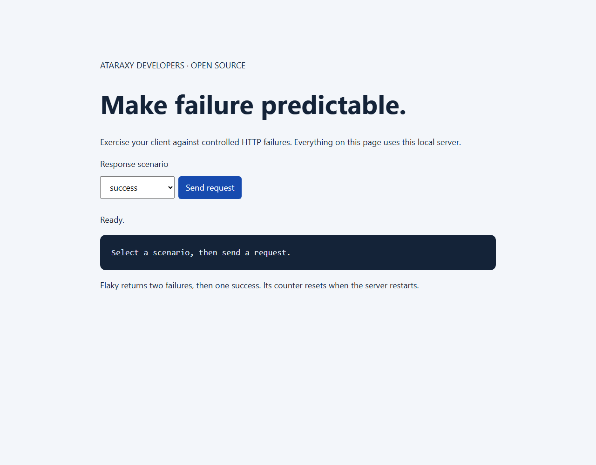

# API Failure Playground

[](https://github.com/AtaraxyDevelopers/api-failure-playground/actions/workflows/ci.yml)
[](LICENSE)

A local HTTP API for exercising slow, failed, expired, and rate-limited responses.

An open-source project from [Ataraxy Developers](https://github.com/AtaraxyDevelopers).



## Quick start

Install [Node.js](https://nodejs.org/en/download) 22 or 24 (npm is included). Check
`node --version` and `npm --version` in your terminal. The commands below run from
this repository's root folder, the one containing `package.json`.

**With Git:**

```sh
git clone https://github.com/AtaraxyDevelopers/api-failure-playground.git
cd api-failure-playground
npm ci
npm test
```

**Without Git:** choose **Code → Download ZIP** on GitHub, extract the archive,
and open a terminal in the extracted `api-failure-playground-main` folder (release archives may
include the version in the folder name). Run `npm ci` and `npm test` there.
Use the **source-code ZIP**, not an npm `.tgz` package, to follow this developer walkthrough.
The install step may need internet access; the examples run locally afterward.

On Windows PowerShell, if `npm.ps1` is blocked by execution policy, use `npm.cmd`
in place of `npm` in these commands. No execution-policy change is required.

```sh
npm start
```

Open **http://127.0.0.1:4310** for the local interactive demo. Or run `npm run demo`
for a self-contained command-line tour that starts and stops its own server.
Leave the server terminal open while using the browser. Press **Ctrl+C** to stop it.

## API

GET `/api/items?scenario=NAME` returns one of:

| Scenario        | Behavior                                         |
| --------------- | ------------------------------------------------ |
| success / empty | 200 with items / an empty list                   |
| slow            | 200 after a configurable delay (default 1500 ms) |
| unauthorized    | 401 with a Bearer challenge                      |
| rate-limit      | 429 with Retry-After: 2                          |
| server-error    | 503                                              |
| malformed       | 200 with intentionally invalid JSON              |
| flaky           | Two 503 responses, then one 200; repeats         |
| disconnect      | Closes the connection without a response         |

GET `/health` returns health and GET `/scenarios` lists the scenarios.
Unknown scenarios return 400; unsupported methods return 405.

```sh
npm start -- --port 4311 --delay 3000
```

Stop the previous server with Ctrl+C before switching options. With the command
above, open **http://127.0.0.1:4311**; the slow scenario takes about three seconds.

## Scope and limitations

This is a development server bound to IPv4 loopback. It has no authentication and
must not be exposed as a production API. No CORS headers are added: use your
frontend development server's proxy to connect from another origin. Flaky state is
shared across clients and resets on restart. The rate-limit scenario always returns
429; Retry-After is an instruction for your client, not an automatic recovery timer.

## Validation

The HTTP integration test exercises every scenario, status codes, headers, delay,
malformed JSON, network failure, method rejection, and the demo document.

## Expected first run

`npm start` prints the local URL and keeps running. The demo tour exits successfully after showing each scenario, including intentional HTTP failures and a disconnected request.

## Contributing and support

See [CONTRIBUTING.md](CONTRIBUTING.md), [community expectations](CODE_OF_CONDUCT.md),
and [SECURITY.md](SECURITY.md). Open an issue with a minimal synthetic reproduction.
This project is maintained on a best-effort basis. No paid service or account is
required to run the local examples.

## License

[MIT](LICENSE). You may use, adapt, and redistribute this project under its license.
